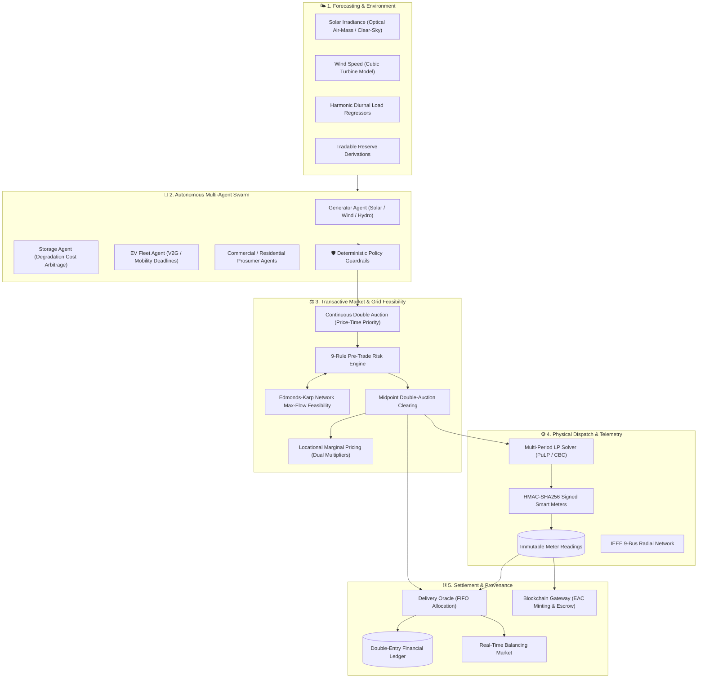

# ⚡ Autonomous Transactive Microgrid Energy Exchange (GreenGrid District)

[](./LICENSE)
[](https://www.python.org/)
[](https://fastapi.tiangolo.com/)
[](https://react.dev/)
[](https://www.typescriptlang.org/)
[](./tests)
[](./docker-compose.yml)

> **A production-grade cyber-physical platform for autonomous transactive microgrid energy trading, distributed AI agent swarms, physics-constrained double auctions, multi-period optimal economic dispatch, immutable smart metering, double-entry financial settlement, and decentralized renewable energy attribute certificates (EACs).**

---

## 📖 Table of Contents
- [🌟 Executive Summary & Core Principle](#-executive-summary--core-principle)
- [🏗️ End-to-End System Architecture](#️-end-to-end-system-architecture)
- [🖥️ Interactive UI Portal (10 Screens)](#️-interactive-ui-portal-10-screens)
- [👥 System Personas: Operators vs. Prosumers](#-system-personas-operators-vs-prosumers)
- [🚀 Quickstart & Project Setup Guide](#-quickstart--project-setup-guide)
  - [Prerequisites](#prerequisites)
  - [Backend Setup](#1-backend-setup)
  - [Database Migration & Seeding](#2-database-migration--seeding)
  - [Frontend Setup](#3-frontend-setup)
  - [Default Demo Credentials](#4-default-demo-credentials)
  - [Running the Test Suites](#5-running-the-test-suites)
  - [Docker Production Stack](#6-docker-production-stack)
- [🧮 Mathematical & Algorithmic Engines](#-mathematical--algorithmic-engines)
- [🤖 Autonomous AI Swarm & Policy Guardrails](#-autonomous-ai-swarm--policy-guardrails)
- [📜 Double-Entry Accounting & Blockchain Settlement](#-double-entry-accounting--blockchain-settlement)
- [⚡ Five Demonstration Stress Scenarios](#-five-demonstration-stress-scenarios)
- [🌐 REST API & Real-Time WebSocket Protocol](#-rest-api--real-time-websocket-protocol)
- [📁 Project Directory Structure](#-project-directory-structure)
- [📄 License & Contributing](#-license--contributing)

---

## 🌟 Executive Summary & Core Principle

Traditional distribution networks treat distributed energy resources (DERs)—such as rooftop solar, home storage batteries, commercial facilities, and electric vehicle fleets—as uncoordinated passive loads. When renewable penetration surges, localized distribution lines experience severe thermal congestion, reverse power flows, and voltage instability.

The **Autonomous Transactive Microgrid Energy Exchange** coordinates distributed community energy resources through dynamic, localized economic incentives while strictly guaranteeing physical electrical engineering constraints.

### 💡 The Core Axiom
> **"AI predicts and proposes. Deterministic guardrails validate. Markets discover local prices. Optimization schedules dispatch. Physical network laws constrain flows. Smart meters prove delivery. Blockchain enforces economic commitments."**



---

## 🖥️ Interactive UI Portal (10 Screens)

The frontend is a reactive single-page dashboard built with **React 19**, **TypeScript**, **Vite**, **Tailwind CSS**, and **Leaflet GIS raster tiles**.

| Route | Screen Name | Key Functionalities |
|---|---|---|
| `/login` | **🔐 Authentication** | Role-based sign-in with instant demo pill switching (`Operator`, `Prosumer`, `Auditor`, `Admin`). |
| `/` | **🗺️ Executive Dashboard** | Top 6 KPI cards, real Carto GIS Digital Twin with feeder polylines, generation mix donut, live trades. |
| `/control-room` | **🕹️ SCADA Control Room** | IEEE 9-bus radial SVG mesh, active energy flow animations, nodal LMP heatmap pills, emergency islanding switch. |
| `/market` | **📈 Transactive Energy Market** | Continuous double-auction order book (mint green bids / rose asks), cleared trade tape, manual order widget. |
| `/agents` | **🤖 Autonomous AI Swarm** | 8-agent swarm roster, LLM natural language reasoning traces, deterministic policy guard checklist, round runner. |
| `/optimization` | **⚙️ Multi-Period LP Dispatch** | 24-hour rolling horizon dispatch schedules, battery SOC trajectories, objective cost breakdown via PuLP/CBC. |
| `/blockchain` | **⛓️ Decentralized Settlement** | Smart contract escrow commitments, GridUSD double-entry token balances, Energy Attribute Certificates (EACs). |
| `/scenarios` | **🌪️ Dynamic Stress Testing** | Live disturbance injection: Cloud Shock, Transmission Bottlenecks, Grid Blackout, Delivery Shortfall. |
| `/analytics` | **📊 Energy & Carbon Analytics** | 7-day self-sufficiency index, carbon abatement stats, participant reliability leaderboards. |
| `/settings` | **⚙️ System Configuration** | Microgrid UUID parameters, simulation playback speed, WebSocket telemetry health checks. |
| *Global* | **⏱️ Demo Director HUD** | Floating bottom bar for time-travel stepping (+15m), auto-play, scenario triggers, and cache invalidation. |

> 🎥 **Detailed Video Recording Guide**: For a screen-by-screen walkthrough and script, see [docs/README.md](file:///c:/Users/SM%20COM/Documents/AUTONOMOUS_MICROGRID_EXCHANGE/docs/README.md).

---

## 👥 System Personas: Operators vs. Prosumers

The platform models the cyber-physical duality between **System Reliability & Grid Physics (Operator)** and **Distributed Economics & Flexibility (Prosumer)**:

### Comparison Matrix
| Dimension | 🛡️ Grid Operator (`GRID_OPERATOR`) | ⚡ Prosumer (`PROSUMER` / `PARTICIPANT`) |
|---|---|---|
| **Primary Mission** | Guarantee grid stability (50 Hz / 1.0 p.u. voltage), prevent feeder thermal overloads, and protect critical hospital loads. | Maximize clean self-consumption, minimize electricity bills, and earn arbitrage/reserve revenues from DERs. |
| **Physical Assets Controlled** | Central Substation Bus, Utility Intertie Breaker, Feeder Switches, Community BESS, Hydro plant. | Rooftop Solar PV (3.5–8.0 kWp), Home Batteries (10–20 kWh), and EV Smart Chargers (V2G). |
| **Operational Authority** | **Supervisory & Emergency**: Circuit breaker trip (Islanding), line deratings, load shedding, and market round dispatch. | **Commercial & Strategic**: Energy order submissions, AI agent strategy configuration, and bilateral flexibility offers. |
| **Market Role** | Market coordinator & balancer of last resort (procures operating reserves, levies shortfall penalties, checks transfer feasibility). | Active market participant (places bids/asks in double auction, delivers verified energy, earns GridUSD and EACs). |
| **Key UI Views** | Control Room (SCADA topology), Scenarios (Stress testing), Optimization (24-hr LP dispatch). | Transactive Market (Order book), AI Swarm (Agent decisions & reasoning), Blockchain (EACs & wallet). |

### Complete Participant Taxonomy (`ParticipantType` Enum)
As defined in [`app/core/enums.py`](file:///c:/Users/SM%20COM/Documents/AUTONOMOUS_MICROGRID_EXCHANGE/app/core/enums.py):
- `GRID_OPERATOR`: Responsible for physical transmission reliability, feeder capacity constraints, and black-start recovery.
- `PROSUMER`: Dual producer-consumer with rooftop solar generation, load, and residential storage.
- `CONSUMER`: Pure off-taker with non-generating residential demand.
- `GENERATOR`: Commercial utility-scale clean energy provider (e.g., Solar Cooperative, Wind Farm, Small Hydro).
- `STORAGE_OPERATOR`: Operates community utility-scale batteries for energy arbitrage, spinning reserves, and resilience floors.
- `EV_OWNER`: Fleet operator or residential vehicle owner offering smart charging and vehicle-to-grid (V2G) ancillary services.
- `COMMERCIAL`: Flexible commercial facilities (offices, shopping plazas, light industry) offering HVAC/demand-response curtailment.
- `CRITICAL_LOAD`: Essential infrastructure (e.g., Hospital 100 kW baseline) with zero-shedding priority ($1,000\times$ penalty factor).

### Grid Operating Modes (`OperatingMode` Enum)
- `GRID_CONNECTED`: Standard synchronized operation; import/export enabled with regional utility.
- `ISLANDED`: Utility intertie disconnected; microgrid autonomously balances local generation, BESS, and critical loads.
- `EMERGENCY`: Active disturbance or severe shortfall; non-critical sheddable loads are automatically curtailed.
- `RECOVERY`: Re-synchronization phase; black-start recovery restoring feeders and matching grid frequency before tie re-closure.

---

## 🚀 Quickstart & Project Setup Guide

### Prerequisites
- **Python**: `3.11` or higher
- **Node.js**: `18.x` or higher (with `npm`)
- **Git**: Installed and configured
- **Docker & Docker Compose** *(Optional for containerized deployment)*

---

### 1. Backend Setup

```bash
# Clone the repository
git clone https://github.com/your-username/AUTONOMOUS_MICROGRID_EXCHANGE.git
cd AUTONOMOUS_MICROGRID_EXCHANGE

# Create and activate a Python virtual environment
python -m venv venv

# On Windows (PowerShell):
.\venv\Scripts\Activate.ps1
# On macOS / Linux:
source venv/bin/activate

# Install Python backend dependencies
pip install -r requirements.txt
```

---

### 2. Database Migration & Seeding

```bash
# Copy example environment configuration
cp .env.example .env

# Run database migrations
python -m alembic upgrade head

# Seed the realistic GreenGrid District dataset (8 buses, DERs, smart meters, historical trades)
python -m app.db.seed
```

---

### 3. Frontend Setup

```bash
# Navigate to the frontend directory
cd frontend

# Install Node dependencies
npm install

# Start the Vite development server
npm run dev
```

The frontend client will launch at: **`http://localhost:3001`**  
The backend REST API and interactive Swagger docs run at: **`http://localhost:8000/docs`**

---

### 4. Default Demo Credentials

All seeded accounts share the default development password: **`admin123`**

| Role / Persona | Seeded Email Account | Default Access Privileges |
|---|---|---|
| **Grid Operator** | `operator@greengrid.local` | Full SCADA, circuit breakers, feeder derating, scenario injection |
| **Prosumer** | `prosumer1@greengrid.local` | Participant portal, personal DER telemetry, order submission, wallet |
| **Auditor** | `auditor@greengrid.local` | Read-only cryptographic audit logs, smart meter telemetry, EAC tracking |
| **Administrator** | `admin@greengrid.local` | Full administrative authority across all microgrid configurations |

---

### 5. Running the Test Suites

The platform includes **84 unit, integration, and physics-domain tests**:

```bash
# Run backend pytest test suite
python -m pytest -v

# Run frontend TypeScript type-checker
cd frontend
npx tsc --noEmit
```

---

### 6. Docker Production Stack

To run the complete production stack (FastAPI backend, PostgreSQL 16, Redis 7, and automated migration runner):

```bash
docker-compose up --build
```

---

## 🧮 Mathematical & Algorithmic Engines

### 1. Continuous Double Auction (Midpoint Pricing)
Orders are ranked by strict Price-Time priority:
- Bids: descending by limit price $P_{\text{bid}}$, then ascending sequence.
- Asks: ascending by limit price $P_{\text{ask}}$, then ascending sequence.

When $P_{\text{bid}} \ge P_{\text{ask}}$, a bilateral match executes at the exact midpoint:
$$P_{\text{trade}} = \frac{P_{\text{bid}} + P_{\text{ask}}}{2}$$
The volume-weighted average across all matches defines the interval's Market Clearing Price ($P_{\text{MCP}}$).

### 2. Physical Feasibility (Edmonds-Karp Max-Flow)
The electrical distribution feeder topology is modeled as a capacitated directed graph $G = (V, E)$ with 8 primary buses and 10 distribution feeders. Candidate transfers between seller $u$ and buyer $v$ are validated against Available Transfer Capacity ($\text{ATC}_{u \to v}$) using the **Edmonds-Karp algorithm**:
$$\sum_{e \in \text{path}(u, v)} \text{Flow}(e) \le \text{ThermalCapacity}(e)$$
If lines are congested, transactions are clamped or diverted to local generation pockets.

### 3. Multi-Period Linear Programming Dispatch (PuLP/CBC)
Solves a 24-hour economic dispatch optimization over 96 quarterly-hour intervals:
$$\min \sum_{t=1}^T \left( C_{\text{gen}}(t) + C_{\text{import}}(t) - R_{\text{export}}(t) + C_{\text{degradation}}(t) + C_{\text{unserved}}(t) + C_{\text{curtail}}(t) \right)$$
Subject to:
- **Kirchhoff's Current Law**: $\sum P_{\text{gen}} + P_{\text{import}} + P_{\text{discharge}} = \sum P_{\text{load}} + P_{\text{export}} + P_{\text{charge}}$
- **Battery Dynamics**: $\text{SOC}(t) = \text{SOC}(t-1) + (\eta_{\text{chg}} P_{\text{chg}} - \frac{1}{\eta_{\text{dis}}} P_{\text{dis}}) \Delta t$
- **EV Mobility Deadlines**: $\text{SOC}_{\text{EV}}(t_{\text{depart}}) \ge \text{TargetSOC}_{\text{EV}}$
- **Zero Critical Curtailment**: Hospital unserved demand penalized at $1,000\times$.

### 4. Pre-Trade Risk Engine & Tradable Reserve
Sellers cannot offer unhedged forecast capacity. Tradable capacity is strictly bounded by lower confidence intervals:
$$\text{TradableCapacity} = \max\left(0, \hat{Y} - z \cdot \sigma - \text{OperationalReserve}\right)$$

---

## 🤖 Autonomous AI Swarm & Policy Guardrails

Phase 4 introduces an intelligent strategic layer operating strictly above the deterministic physical and economic infrastructure:

```
[ LLM Strategic Reasoning ]  --> Proposes Bid / Ask (Action, Quantity, Limit Price)
            │
            ▼
[ Deterministic Policy Guard ] --> Clamps / Approves / Rejects based on physical limits
            │
            ▼
[ Transactive Double Auction ] --> Clears via Midpoint Pricing and Max-Flow feasibility
```

### Specialized Swarm Agents
1. **Generator Agent**: Strategically hedges renewable uncertainty against penalty risks and reserve revenues.
2. **Battery Storage Agent (A1)**: Optimizes multi-interval arbitrage and reserve commitment while accounting for battery cycle degradation.
3. **EV Fleet Agent**: Maximizes V2G revenue while guaranteeing driver mobility deadlines.
4. **Prosumer Agent**: Balances self-consumption, storage buffering, and transactive market sales.
5. **Consumer & Commercial Agents**: Evaluates demand-response incentives and defers non-critical HVAC processes.
6. **Grid AI Advisor**: Advisory observer alerting operators to congestion and islanding risks without autonomous line-switching authority.
7. **Market Analyst Agent**: Generates structured, natural language market explanations grounded in verified telemetry.

### Deterministic Safety Guardrails
- **Zero Direct Execution Authority**: LLMs propose trades; deterministic Python validators approve or reject.
- **Physical Safety Invariants**: Bids cannot exceed inverter ratings, battery SOC cannot violate $20\% \le \text{SOC} \le 95\%$, and critical hospital power is untouchable.
- **Circuit Breaker Fallback**: Automatic failover to deterministic rule-based dispatch if an LLM times out or produces invalid schema output.

---

## 📜 Double-Entry Accounting & Blockchain Settlement

### 1. Conservation of Money
All financial movements adhere to strict double-entry ledger bookkeeping. Every transaction contains balanced debit and credit entries summing to zero across six dedicated accounts:
- `AVAILABLE`: Freely tradeable liquidity.
- `LOCKED`: Collateral held in escrow during active orders and commitments.
- `PENDING_SETTLEMENT`: Funds allocated awaiting smart meter proof of delivery.
- `SETTLED`: Final delivered value transferred to sellers.
- `SYSTEM_PENALTY`: Penalty pool receiving shortfall fines and paying balancing reserves.
- `SYSTEM_EQUITY`: System liquidity account compensating demand response providers.

### 2. Smart Meter Delivery Oracle
No settlement executes without physical proof:
1. Delivery verification compares smart meter readings against commitment obligations:
   $$\text{Ratio} = \min\left(1.0, \frac{Q_{\text{delivered}}}{Q_{\text{committed}}}\right)$$
2. Seller payment: $S_{\text{pay}} = Q_{\text{delivered}} \times P_{\text{cleared}}$
3. Buyer refund: $B_{\text{refund}} = (Q_{\text{committed}} - Q_{\text{delivered}}) \times P_{\text{cleared}}$
4. Shortfall penalty:
   $$\text{Penalty} = (Q_{\text{committed}} - Q_{\text{delivered}}) \times P_{\text{cleared}} \times \text{Multiplier}_{\text{penalty}}$$

### 3. Renewable Energy Attribute Certificates (EACs)
- Minted exclusively against verified renewable generation readings (`verified=True`, renewable source).
- Database unique constraints on `meter_reading_id` prevent double issuance.
- Lifecycle: `ISSUED` $\rightarrow$ `TRANSFERRED` $\rightarrow$ `RETIRED`.

---

## ⚡ Five Demonstration Stress Scenarios

The platform includes five pre-configured operational stress scenarios accessible via `/scenarios`:

| Preset | Name | Disturbance Mechanism | Operational & Market Effect |
|:---:|---|---|---|
| **A** | **Normal Market** | Nominal clear sky, baseline demand | Stable LMPs, balanced renewables, active peer-to-peer trading. |
| **B** | **Cloud Shock** | 60% sudden drop in solar irradiance | Generation deficit triggers battery discharge and operating reserve activation. |
| **C** | **Grid Congestion** | Feeder line capacity derated by 65% | Max-flow bottleneck restricts trades; downstream nodes experience LMP spikes. |
| **D** | **Grid Outage** | Utility interconnection breaker trips | Instant islanding, commercial load shedding, 100% hospital load preservation. |
| **E** | **Delivery Failure** | Generator underdelivers during committed window | Delivery oracle slashes collateral, refunds buyer, and flags surveillance alert. |

---

## 🌐 REST API & Real-Time WebSocket Protocol

The backend exposes over **70 fully documented REST endpoints** via OpenAPI/Swagger at `/docs`:

- `/auth`: User authentication, JWT issuance, and RBAC profile inspection.
- `/microgrids` & `/participants`: Network limits, participant wallets, and trading preferences.
- `/assets`, `/batteries`, `/evs`: DER physical asset specifications, SOC tracking, and V2G flags.
- `/grid`: IEEE 9-bus electrical topology, line thermal limits, and feeder derating.
- `/meters` & `/meter-readings`: HMAC-SHA256 authenticated smart meter ingestion and immutable logs.
- `/forecasts`: Optical air-mass solar and harmonic load forecasting models.
- `/orders` & `/orderbook`: Continuous double-auction order book and depth curves.
- `/market`: Midpoint market clearing, trade logs, and LMP calculation.
- `/agents`: Autonomous swarm configuration, LLM decision history, and round execution.
- `/optimization`: PuLP linear programming 24-hr economic dispatch runs.
- `/settlements` & `/ledger`: Double-entry accounting accounts, transactions, and settlement execution.
- `/renewable-proofs`: Energy Attribute Certificate (EAC) issuance, transfer, and retirement.
- `/resilience`: Islanding controller, utility outage declaration, and recovery resynchronization.
- `/simulation`: Virtual clock control, scenario injection, and environmental noise models.

### Real-Time WebSocket Streaming
Connect via WebSocket at:
```
ws://localhost:8000/ws?microgrid_id={id}&channels=telemetry,market,grid,alerts
```
Subscribers receive real-time JSON event envelopes for `MICROGRID_STATE`, `ORDER_CREATED`, `MARKET_CLEARED`, `GRID_CONGESTION`, `METER_READING`, `SETTLEMENT`, and `ISLAND_MODE`.

---

## 📁 Project Directory Structure

```
AUTONOMOUS_MICROGRID_EXCHANGE/
├── .env.example              # Sample environment configuration template
├── Dockerfile                # Production backend container definition
├── docker-compose.yml        # Orchestration for FastAPI, PostgreSQL, Redis
├── requirements.txt          # Python core dependencies
├── pytest.ini                # Pytest test-suite configuration
├── LICENSE                   # MIT Open Source License
├── README.md                 # Primary GitHub repository documentation
├── docs/                     # Detailed architectural guides and video scripts
│   ├── README.md             # Complete Video Production & Screen Walkthrough Guide
│   ├── AI_AGENT_ARCHITECTURE.md
│   └── BLOCKCHAIN_THREAT_MODEL.md
├── app/                      # Backend domain-driven modular monolith
│   ├── agents/               # Autonomous AI swarm & deterministic guardrails
│   ├── analytics/            # KPIs, self-sufficiency, carbon intensity
│   ├── api/                  # FastAPI routers and dependency injection
│   ├── assets/               # DER property models (Battery, EV, Load, Solar)
│   ├── audit/                # Immutable append-only audit event logging
│   ├── balancing/            # Real-time balancing market engine
│   ├── blockchain/           # Blockchain gateway & EVM integration
│   ├── core/                 # Shared enums, security, configuration
│   ├── db/                   # SQLAlchemy async engine, sessions, seed data
│   ├── forecasting/          # Solar, wind, and harmonic load models
│   ├── grid/                 # Network topology, line capacities, max-flow
│   ├── market/               # Continuous order book & double-auction clearing
│   ├── meters/               # HMAC smart meters & immutable readings
│   ├── models/               # SQLAlchemy ORM database models
│   ├── optimization/         # PuLP/CBC multi-period LP economic dispatch
│   ├── participants/         # Participant profiles & reliability tracking
│   ├── provenance/           # Energy Attribute Certificates (EACs)
│   ├── resilience/           # Islanding state machine & emergency recovery
│   ├── risk/                 # 9-rule pre-trade risk validation engine
│   ├── schemas/              # Pydantic v2 data transfer schemas
│   ├── settlement/           # Double-entry financial accounting ledger
│   ├── simulation/           # Virtual clock, environmental signals, scenarios
│   └── websocket/            # Real-time WebSocket broadcasting
├── frontend/                 # React 19 + TypeScript single-page application
│   ├── src/
│   │   ├── api/              # Axios / Fetch client and endpoint bindings
│   │   ├── components/       # Reusable UI cards, maps, charts, and layout
│   │   ├── pages/            # The 10 application screen views
│   │   ├── stores/           # Zustand state stores (microgrid, user auth)
│   │   └── websocket/        # Reactive WebSocket hook and event stream
│   ├── package.json          # Node.js dependencies
│   └── vite.config.ts        # Vite build and dev-server configuration
└── tests/                    # 84 unit, integration, and physics-domain tests
```

---

## 📄 License & Contributing

### License
This project is licensed under the **MIT License** — see the [LICENSE](./LICENSE) file for complete details. You are free to use, modify, distribute, and integrate this software in research, commercial, and municipal projects.

### Contributing
Contributions are welcomed! Please follow these guidelines:
1. Fork the repository and create your feature branch (`git checkout -b feature/AmazingFeature`).
2. Verify that all 84 test cases pass (`python -m pytest -v`) and TypeScript compiles with zero errors (`npx tsc --noEmit`).
3. Commit your changes with descriptive commit messages (`git commit -m 'feat: Add dynamic EV charging degradation factor'`).
4. Push to the branch (`git push origin feature/AmazingFeature`) and open a Pull Request.

---

*Autonomous Transactive Microgrid Energy Exchange &bull; GreenGrid District Digital Twin &bull; 2026*
